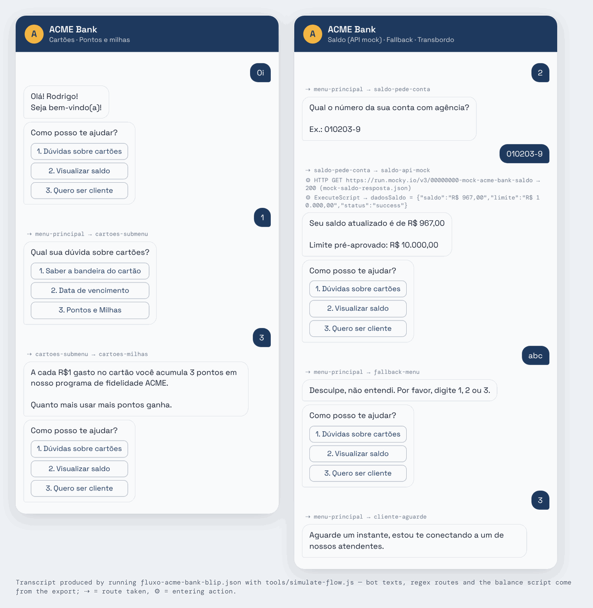
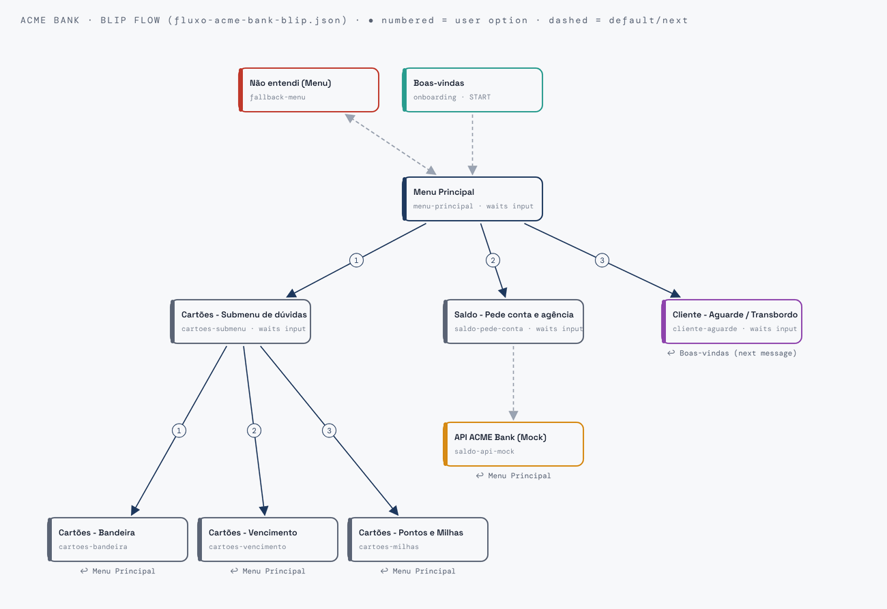

# ACME Bank Chatbot (Blip + Dialogflow)

Customer-service chatbot for a **fictional bank (ACME Bank)**, built on **Blip Builder**. Customers can ask about cards, check their balance through an API, sign up as new customers and be handed off to a human agent. An optional **Dialogflow** layer lets them type freely ("quero ver meu saldo") instead of choosing 1, 2 or 3. It connects through a small **Google Cloud Function** proxy.

Academic project for the PUC Minas postgraduate program in Data Science & AI. Bot texts are in Portuguese.


<sub>Real output of `tools/simulate-flow.js` running `fluxo-acme-bank-blip.json`. Every bot message, route and the balance script come from the flow file. The balance is the mock API response (`mock-saldo-resposta.json`).</sub>

---

## The conversation flow



| Block | What happens |
|---|---|
| **Boas-vindas** | Greets the customer by name (`{{contact.name}}`) |
| **Menu Principal** | `1` cards · `2` balance · `3` become a customer. Matches numbers or words via regex, e.g. `^(2|saldo|visualizar.*saldo)$` |
| **Cartões** submenu | `1` card brands · `2` due dates · `3` points & miles, then back to the menu |
| **Saldo** | Asks for account + branch, calls the balance API (`GET` request), extracts the values with a script and shows *"Seu saldo atualizado é de R$ 967,00 / Limite pré-aprovado: R$ 10.000,00"* |
| **Cliente / Transbordo** | Hands the conversation to a human agent and waits |
| **Não entendi** | Fallback for unrecognised input, then shows the menu again |

### Try it without a Blip account
```bash
node tools/simulate-flow.js "Oi" "2" "010203-9"     # each argument = one customer message
node tools/simulate-flow.js                        # default demo conversation
```
```
USER > Oi
BOT  < Olá! Rodrigo! | Seja bem-vindo(a)!
BOT  < Como posso te ajudar? | 1. Dúvidas sobre cartões | 2. Visualizar saldo | 3. Quero ser cliente
USER > 2
   -> menu-principal -> saldo-pede-conta
BOT  < Qual o número da sua conta com agência? | Ex.: 010203-9
...
BOT  < Seu saldo atualizado é de R$ 967,00 | Limite pré-aprovado: R$ 10.000,00
```

---

## Building it in Blip
Blip only re-imports JSON files it exported itself, so `fluxo-acme-bank-blip.json` is the **reference specification**: blocks, texts, regex outputs and the API script. You rebuild it in the Builder in about 15 minutes:

1. Follow **`guia-montagem-blip.md`** (step-by-step) or **`checklist-montagem-blip.md`**. `files/blueprint-completo.md` has the full 13-block version, including the human hand-off panel.
2. Create the balance mock with **`guia-mock-saldo.md`**: a Mocky.io endpoint returning `mock-saldo-resposta.json`.

## Optional: free-text understanding with Dialogflow
Blip can't sign the OAuth2 token that Dialogflow v2 requires, so a **Cloud Function** proxy does it:

```
Blip block "Dialogflow NLP" ──POST + x-api-key──► Cloud Function (05-cloud-function.js) ──detectIntent──► Dialogflow
           ◄── intent + confidence (03-script-parse.js) ──┘
```
| File | Role |
|---|---|
| `files/05-cloud-function.js` | Proxy: checks `x-api-key`, calls Dialogflow `detectIntent`, returns `intent`, `confidence` and the reply |
| `files/01-request-body.json`, `02-conector-config.json` | Request body and HTTP-request block configuration for Blip |
| `files/03-script-parse.js`, `04-response-exemplo.json` | Blip script that turns the answer into `{intent, confianca, resposta}`, and an example answer |
| `files/intencoes-nlp.json` | Intents + training phrases (for Blip's AI tab or your Dialogflow agent) |

Name the Dialogflow intents `duvidas_cartoes`, `consultar_saldo` and `novo_cliente` so they match the block's output conditions. Answers with confidence below 0.5 go to the fallback.

**Deploy:** the full `gcloud functions deploy` command is at the top of `05-cloud-function.js`. Attach a service account that has Dialogflow access, so **no key file is needed**.

**Tests** (they run offline; Dialogflow is replaced by a fake):
```bash
cd files && npm test      # 5 tests: auth, input validation, Dialogflow call, Blip parse script
```

## API keys
This repository contains **no keys or credentials**. Copy `.env.example` to `.env` and set:
- `PROJECT_ID`: your Google Cloud project
- `PROXY_API_KEY`: a long random string. The same value goes in the Blip resource `proxyApiKey`.

The proxy **refuses to run without `PROXY_API_KEY`**, because it's deployed as a public URL. `.env` and Google service-account JSON files are in `.gitignore`.

**Author:** Rodrigo Chemite Barbosa · [github.com/ch3m1bb5](https://github.com/ch3m1bb5)
